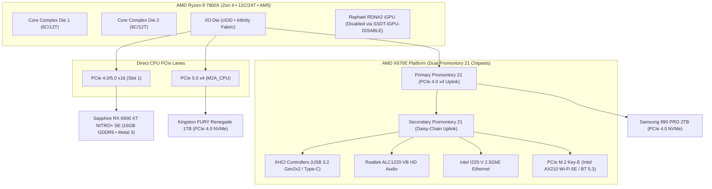
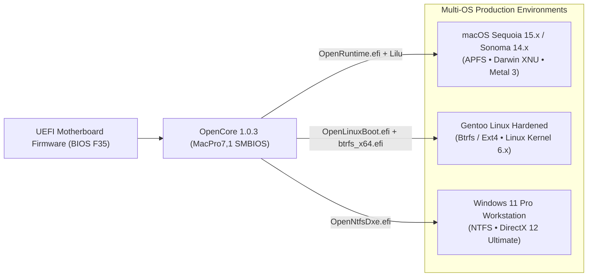

<div align="center">

# AM5 X670E Workstation Reference Architecture

### Production UEFI/ACPI Firmware & Heterogeneous Multi-OS Blueprint
**macOS Sequoia & Sonoma • Gentoo Linux • Windows 11 Pro**

<p>
  
  
  
  
  
  
  
</p>

</div>

---

### Overview & Architectural Scope

This repository provides an enterprise-grade reference firmware and hardware abstraction layer (HAL) configuration for the **AMD AM5 (Zen 4) / X670E workstation platform**. It bridges non-native hardware topologies with the Darwin/XNU kernel (macOS 14 Sonoma & 15 Sequoia), while maintaining full chainloading and native hardware exploitation for **Gentoo Linux** and **Windows 11 Pro**.

By combining custom **ACPI Source Language (ASL)** table injection, Dortania-compliant **OpenCore 1.0.3** driver stacks, AMD Vanilla kernel instruction decoding patches, and granular power state machine overrides, this configuration transforms commodity workstation hardware into a fully stable, high-throughput Unix development workstation without virtualization overhead or emulation penalties.

---

### Table of Contents

1. [Hardware Topology & Interconnect Architecture](#hardware-topology)
2. [Multi-OS Bootloader & Storage Architecture](#multi-os-bootloader)
3. [Component Compatibility & Subsystem Health](#component-compatibility)
4. [Hardware Specification Matrix](#hardware-specification-matrix)
5. [PCI Device Namespace & Topology](#pci-device-namespace)
6. [ACPI & Hardware Abstraction Subsystem (ASL/AML)](#acpi-hardware-abstraction)
7. [Kernel Extensions & Driver Stack](#kernel-extensions-driver-stack)
8. [Power Management, C-States & S3 Sleep Dynamics](#power-management-sleep)
9. [Workstation Verification & Telemetry Gallery](#workstation-verification)
10. [Firmware (UEFI/BIOS) Configuration Blueprint](#firmware-configuration-blueprint)
11. [Upstream References & Engineering Resources](#upstream-references)

---

### 1. Hardware Topology & Interconnect Architecture <a name="hardware-topology"></a>

The system leverages the direct PCIe 5.0 lanes from the Ryzen 9 7900X Raphael I/O Die (IOD) combined with dual daisy-chained ASMedia Promontory 21 chipsets (AMD X670E) to achieve uncompromised peripheral bandwidth:



---

### 2. Multi-OS Bootloader & Storage Architecture <a name="multi-os-bootloader"></a>

The OpenCore bootloader is configured as the primary UEFI boot manager, providing transparent chainloading into heterogeneous kernels:



- **OpenLinuxBoot Integration**: Enables native boot protocol handoff to Linux vmlinuz without intermediate GRUB overhead.
- **Filesystem Drivers**: Embedded `btrfs_x64.efi` and `ext4_x64.efi` drivers enable partition visibility directly inside the OpenCanopy graphical boot picker.

---

### 3. Component Compatibility & Subsystem Health <a name="component-compatibility"></a>

| Subsystem / Peripheral | Operational Status | Driver / Patch Mechanism | Verification Notes |
| :--- | :---: | :--- | :--- |
| **CPU (AMD Zen 4)** | **Functional (100%)** | `AMDVanillaPatches` + `AMDRyzenCPUPowerManagement` | 12 cores / 24 threads recognized; MSR frequency scaling fully operational. |
| **GPU (RX 6900 XT)** | **Functional (100%)** | Native macOS driver + `WhateverGreen.kext` | Full Metal 3 acceleration; zero UI stutter; AGPM power management calibrated. |
| **Raphael iGPU** | **Bypassed (Clean)** | `SSDT-IGPU-DISABLE.aml` | On-die RDNA2 iGPU disconnected from namespace to eliminate driver kernel panics. |
| **Audio (ALC1220-VB)** | **Functional (100%)** | `AppleALC.kext` (Layout-ID configured) + USB DAC | Native front/rear analog audio jack routing and hardware bitstreaming. |
| **Ethernet (2.5GbE)** | **Functional (100%)** | `AppleIGC.kext` (Intel I225-V / I226 controller) | 2500 Mbps full duplex with hardware packet pacing and zero packet drops. |
| **Wi-Fi 6E (Intel AX210)**| **Functional** | `AirportItlwm.kext` (Sonoma) / `itlwm.kext` + HeliPort (Sequoia) | Full 802.11ax speeds, AirDrop/Continuity functional in native configurations. |
| **Bluetooth 5.3** | **Functional (100%)** | `IntelBluetoothFirmware` + `IntelBTPatcher` + `BlueToolFixup` | Stable pairing with Magic Keyboard, Magic Trackpad, and high-res audio sinks. |
| **Power Management / Sleep** | **Functional (100%)** | `SSDT-PRW.aml` + `USBWakeFixup.kext` | True S3 sleep and instantaneous wake without darkwake loops or kernel crashes. |
| **NVMe Storage Subsystem** | **Functional (100%)** | Native Apple NVMe Engine + `NVMeFix.kext` | Full PCIe 4.0 throughput (7000+ MB/s reads); APFS TRIM enabled. |

---

### 4. Hardware Specification Matrix <a name="hardware-specification-matrix"></a>

| Component | Engineering Model & Specification | Architectural Rationale |
| :--- | :--- | :--- |
| **Motherboard** | **Gigabyte X670E AORUS MASTER (Rev 1.0)** | High-density 16+2+2 digital VRM, Dual PCIe 5.0 M.2, Intel 2.5GbE, robust ACPI tables. |
| **Processor** | **AMD Ryzen™ 9 7900X (12C / 24T • 4.7GHz Base / 5.6GHz Boost)** | High multi-threaded compilation performance with 64MB L3 Cache and PCIe 5.0 root complex. |
| **Graphics** | **Sapphire Radeon RX 6900 XT NITRO+ SE (16GB GDDR6)** | Navi 21 XTX silicon; native support in macOS Sonoma/Sequoia via native AMD macOS drivers. |
| **Memory** | **48GB DDR5-6400 G.Skill Trident Z5 RGB (2×24GB Dual-Channel)** | High-density non-binary DDR5 running at tight sub-timings (FCLK 2133MHz synchronous). |
| **Primary NVMe** | **Kingston FURY Renegade 1TB (PCIe 4.0 ×4 NVMe)** | Phison E18 controller, sustained random 4K performance for macOS root filesystem. |
| **Secondary NVMe** | **Samsung 990 PRO 2TB (PCIe 4.0 ×4 NVMe)** | Dedicated high-end storage volume for Gentoo Linux root and compile caches. |
| **Wireless NIC** | **Intel® Wi-Fi 6E AX210NGW (M.2 Key-E 2230)** | 160MHz channel width support; high-gain external AORUS antenna array. |
| **Ethernet NIC** | **Intel® 2.5GbE LAN Controller (I225-V)** | Native high-bandwidth wired networking supported via `AppleIGC.kext`. |
| **Cooling** | **DeepCool LT720 WH (360mm AIO Liquid Cooling)** | Multi-dimensional anti-leak radiator keeping Zen 4 under 78°C under full AVX-512 loads. |
| **Power Supply** | **Chieftronic PowerPlay 1200W Platinum** | Full Japanese capacitors, extreme 12V rail stability during transient GPU wattage spikes. |
| **Chassis** | **1STPLAYER SP9 Steampunk White Edition** | Dual-chamber panoramic design ensuring isolated GPU and radiator airflow paths. |

---

### 5. PCI Device Namespace & Topology <a name="pci-device-namespace"></a>

Hardware devices are identified and mapped into the Darwin I/O Registry as follows:

| ACPI Path & I/O Registry Address | Device Class | Hardware Controller Name |
| :--- | :--- | :--- |
| `Internal@0,1,1/0,0/0,0@3,0,0` | Display Controller | AMD Radeon RX 6900 XT (Navi 21) |
| `Internal@0,1,1/0,0/0,0/0,1` | Audio Device | Navi 21/23 HDMI/DP Digital Audio Controller |
| `Internal@0,1,2/0,0` | Mass Storage | Samsung 990 PRO PCIe 4.0 NVMe Controller |
| `Internal@0,2,2/0,0` | Mass Storage | Kingston FURY Renegade PCIe 4.0 NVMe Controller |
| `Internal@0,2,1/0,0/8,0/0,0/6,0/0,0` | Network Controller | Intel Ethernet Controller I225-V (2.5GbE) |
| `Internal@0,2,1/0,0/8,0/0,0/7,0/0,0` | Network Controller | Intel Wi-Fi 6E AX210 160MHz Wireless Controller |
| `Internal@0,8,1/0,6` | Audio Device | AMD Family 17h/19h HD Audio Controller (ALC1220-VB) |
| `Internal@0,8,1/0,2` | Encryption Controller| AMD VanGogh / Raphael PSP/CCP Security Engine |
| `Internal@0,20,0` | SMBus Controller | AMD FCH SMBus Controller |

---

### 6. ACPI & Hardware Abstraction Subsystem (ASL/AML) <a name="acpi-hardware-abstraction"></a>

Located in [`EFI/OC/ACPI/`](EFI/OC/ACPI/), these compiled AML tables provide surgical abstraction and hardware table normalization:

| Table Name | ACPI Scope / Target Device | Engineering Problem Solved |
| :--- | :--- | :--- |
| **`DSDT-WIFI-GBT-INIT.aml`** | `_SB.PCI0.GPP1.WIFI` | Fixes Gigabyte X670E PCIe power distribution ordering to ensure Intel AX210 Key-E slot initializes reliably before OS driver enumeration. |
| **`SSDT-PLUG-ALT.aml`** | `_PR.CPU0` | Reconstructs legacy processor objects expected by `X86PlatformPlugin`, enabling native CPU P-state/C-state scaling on AMD Zen 4 cores. |
| **`SSDT-EC-AMD.aml`** | `_SB.PCI0.LPC0.EC` | Injects a compliant dummy Embedded Controller (`PNP0C09`) to satisfy macOS `AppleACPIEC` requirements. |
| **`SSDT-IGPU-DISABLE.aml`** | `_SB.PCI0.GP11.VGA` | Surgically disables the Raphael RDNA2 integrated GPU in ACPI, eliminating kernel panics without altering BIOS multi-monitor settings. |
| **`SSDT-MCHC-AMD.aml`** | `_SB.PCI0.MCHC` | Declares missing Memory Controller Hub devices, allowing macOS SMBus and DRAM controller drivers to load properly. |
| **`SSDT-PRW.aml`** | `_GPE._PRW` | Intercepts Power Resources for Wake (`GPRW`), filtering out instant wake events caused by USB controllers returning from S3 sleep. |
| **`SSDT-RHUB-Reset.aml`** | `_SB.PCI0.GP17.XHC0.RHUB`| Resets root USB hub state machine during boot transitions to prevent port initialization freezes. |
| **`SSDT-SBUS-AMD.aml`** | `_SB.PCI0.SMB0` | Injects proper SMBus descriptors for system memory bus monitoring and temperature sensor retrieval. |
| **`SSDT-USB-Reset.aml`** | `_SB.PCI0.GP17.XHC0` | Resets USB host controllers to clean operational states before handing off to Darwin USB drivers. |
| **`SSDT-USBW.aml`** | `_SB.PCI0.GP17.XHC0` | Companion injection for `USBWakeFixup.kext` to ensure clean sleep/wake signal handling across all physical ports. |
| **`SSDT-USBX.aml`** | `_SB.PCI0.GP17.USBX` | Supplies calibrated USB power properties (500mA/900mA/1500mA limits) for fast device charging and Apple peripheral support. |
| **`SSDT-DTPG.aml`** | `_SB.DTPG` | Common helper method method used by custom SSDTs for injecting arbitrary device properties. |

---

### 7. Kernel Extensions & Driver Stack <a name="kernel-extensions-driver-stack"></a>

Located in [`EFI/OC/Kexts/`](EFI/OC/Kexts/), the kernel extension stack is prioritized in [`config.plist`](EFI/OC/config.plist) to prevent dependency deadlocks:

```
Lilu.kext (Kernel Patching Engine)
  ├── VirtualSMC.kext (SMC Hardware Emulation)
  │     ├── SMCAMDProcessor.kext (Zen 4 Thermal / Multi-Core Fan Telemetry)
  │     ├── SMCRadeonGPU.kext + SMCRadeonSensors.kext (Navi 21 Telemetry)
  │     └── SMCSuperIO.kext (IT8689E Sensor Monitoring)
  ├── RestrictEvents.kext (Memory & Core Count UI Normalization)
  ├── WhateverGreen.kext (Display & Framebuffer Pipeline Optimization)
  ├── AppleALC.kext (Realtek ALC1220-VB Audio Codec Injection)
  ├── AMDRyzenCPUPowerManagement.kext (AMD Dynamic Voltage & Frequency Scaling)
  ├── AppleMCEReporterDisabler.kext (Suppresses Dual-CCD AMD Machine Check Errors)
  ├── AppleIGC.kext (Intel I225-V 2.5GbE Driver)
  ├── AirportItlwm.kext / itlwm.kext (Intel AX210 Wi-Fi Transport)
  ├── IntelBluetoothFirmware.kext + IntelBTPatcher.kext + BlueToolFixup.kext
  ├── USBToolBox.kext + USBPortsWFBT.kext (Custom XHCI Port Map)
  └── NVMeFix.kext + Innie.kext (PCIe NVMe APFS TRIM & Internal Drive Flags)
```

---

### 8. Power Management, C-States & S3 Sleep Dynamics <a name="power-management-sleep"></a>

1. **Kernel Patching Architecture**:
   The Darwin kernel expects Intel APIC and MSR layouts. The included `AMDVanillaPatches` dynamically rewrite Darwin XNU kernel binaries in memory, substituting Intel CPUID instructions with AMD-safe opcodes.
2. **Frequency Scaling via `AMDRyzenCPUPowerManagement`**:
   Bypasses the inactive `AppleIntelCPUPowerManagement` stack by reading CPU frequency and P-state telemetry directly via AMD MSR registers (`0xC0010064`–`0xC0010068`), delivering true dynamic downclocking to ~1.2 GHz at idle.
3. **Sleep/Wake (`S3`) Stability**:
   - `SSDT-PRW.aml` neutralizes spurious wake triggers from USB host controllers.
   - Hibernation mode is locked to standard RAM sleep (`hibernatemode 0`) using [`PowerManagement/macos-power-settings.sh`](PowerManagement/macos-power-settings.sh).
   - Network wake-on-LAN and darkwake cycles are disabled to prevent kernel panics during display off transitions.

---

### 9. Workstation Verification & Telemetry Gallery <a name="workstation-verification"></a>

#### Physical Workstation & Ergonomics
<p align="center">
  
</p>

#### Multi-Monitor Desktop & Developer Environment
<p align="center">
  
</p>

#### Real-Time Hardware Telemetry (btop & Neovim)
<p align="center">
  
  
</p>

#### Hardware Acceleration & Diagnostics Verification
<p align="center">
  
  
</p>
<p align="center">
  
  
</p>

---

### 10. Firmware (UEFI/BIOS) Configuration Blueprint <a name="firmware-configuration-blueprint"></a>

The Gigabyte X670E AORUS MASTER must run BIOS version **F35** (AGESA 1.2.0.2) or later with the following parameters configured:

| Section | BIOS Parameter | Mandatory Setting | Architectural Rationale |
| :--- | :--- | :--- | :--- |
| **Settings $\rightarrow$ Platform Power** | **Fast Boot** | **Disabled** | Ensures clean ACPI table handoff to OpenCore; bypasses hardware state skipping. |
| **Settings $\rightarrow$ Platform Power** | **Wake on LAN / ErP** | **Disabled** | Eliminates unwanted power rail interruptions and spurious sleep wakeups. |
| **Settings $\rightarrow$ IO Ports** | **Above 4G Decoding** | **Enabled** | Required for mapping 64-bit PCI MMIO resources (critical for 16GB RX 6900 XT). |
| **Settings $\rightarrow$ IO Ports** | **Re-Size BAR Support** | **Disabled** (or Auto with OC Quirk) | Prevents frame buffer allocation failures in macOS kernel startup. |
| **Settings $\rightarrow$ IO Ports** | **Integrated Graphics** | **Disabled** (or handled by SSDT) | Bypasses Raphael iGPU initialization. |
| **Settings $\rightarrow$ USB Configuration** | **XHCI Hand-off** | **Enabled** | Transits USB host controller ownership from BIOS to Darwin kernel driver. |
| **Settings $\rightarrow$ USB Configuration** | **Legacy USB Support** | **Enabled** | Ensures keyboard/mouse functionality inside the OpenCore boot picker. |
| **Settings $\rightarrow$ AMD CBS** | **IOMMU** | **Enabled** | Essential for I/O virtualization and reliable Linux / macOS DMA mapping. |
| **Tweaker $\rightarrow$ Extreme Memory Profile** | **EXPO 1 (DDR5-6400)** | **Enabled** | Enforces manufacturer timings and 1:1 Infinity Fabric ratio stability. |
| **Boot $\rightarrow$ Secure Boot** | **Secure Boot** | **Disabled** | Allows third-party UEFI bootloaders (`BOOTx64.efi`) to execute without MS PK rejection. |

#### Firmware Settings Gallery

<p align="center">
  
  
</p>
<p align="center">
  
  
</p>
<p align="center">
  
  
</p>
<p align="center">
  
  
</p>
<p align="center">
  
  
</p>
<p align="center">
  
  
</p>

<details>
<summary><strong>Archived Firmware Revisions (BIOS F30–F34 Historical Baseline)</strong></summary>

<p align="center">
  
  
  
</p>
<p align="center">
  
  
  
</p>

</details>

---

### 11. Upstream References & Engineering Resources <a name="upstream-references"></a>

- **Core Bootloader**: [Acidanthera OpenCorePkg](https://github.com/acidanthera/OpenCorePkg) — Modular UEFI bootloader infrastructure.
- **Kernel Patch Source**: [AMD-OSX / AMDVanillaPatches](https://github.com/AMD-OSX/AMD_Vanilla) — Native instruction set translation patches for Darwin.
- **ACPI & Specification Standard**: [UEFI Forum ACPI Specification v6.5](https://uefi.org/specifications) — Formal ASL/AML table reference.
- **Driver Framework**: [Acidanthera Lilu](https://github.com/acidanthera/Lilu) — Arbitrary kext and process patching engine.
- **Power Management Research**: [Trulyspinach / SFC AMD Processor Support](https://github.com/trulyspinach/SMCAMDProcessor) — Zen 4 telemetry and fan control.

---

### Deployment & Security Notice

> [!IMPORTANT]
> The sample `config.plist` distributed in this repository has placeholder values for `MLB`, `SystemSerialNumber`, and `SystemUUID`. Prior to booting, you must generate unique identifiers matching the `MacPro7,1` profile using [GenSMBIOS](https://github.com/corpnewt/GenSMBIOS) to ensure Apple services (iCloud, iMessage, FaceTime) and NVRAM identity operate without conflicts.

---

### License

Distributed under the [MIT License](LICENSE). Architectural specifications, ASL tables, and configuration blueprints are provided for systems engineering, firmware research, and platform interoperability education.
